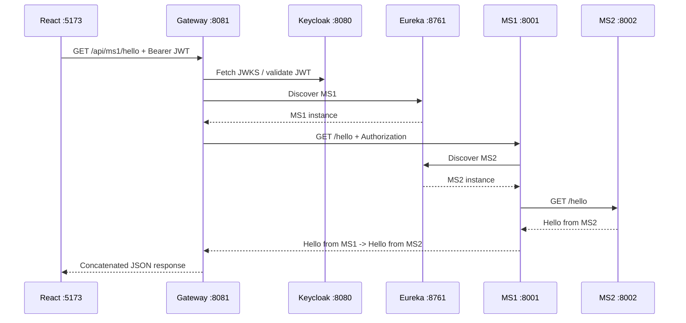

# Agriculture Gateway

Reactive edge service for the agriculture platform. It performs OpenID Connect login
against Keycloak, validates bearer JWTs for API calls, and discovers downstream
services through Eureka. This document explains how the gateway works, how a request
travels through it, and how to run and troubleshoot it.

## Stack

| Component | Version |
| --- | --- |
| Java | 17 |
| Spring Boot | 4.1.2 |
| Spring Cloud | 2025.1.4 |
| Spring Cloud Gateway (server webflux) | 5.0.4 |
| Spring Security | 7.1.2 |
| Maven Wrapper | 3.9.16 |
| Identity provider | Keycloak, realm `agriculture` (`http://localhost:8080`) |
| Discovery | Eureka server (`http://localhost:8761`) |
| Microservice 1 | FastAPI, `MS1` (`http://localhost:8001`) |
| Microservice 2 | FastAPI, `MS2` (`http://localhost:8002`) |
| Refrigerator service | Spring Boot, `REFRIGERATOR-SERVICE` (`http://localhost:8083`) |
| Logistics service | Spring Boot, `LOGISTICS-SERVICE` (`http://localhost:8087`) |

## Architecture

The gateway is a standard Spring Boot WebFlux application. It has three jobs:

1. **Authentication** - it is an OAuth2/OIDC *client*. Users log in through Keycloak
   and the gateway keeps the resulting tokens in the HTTP session for browser flows.
2. **JWT resource server** - it validates `Authorization: Bearer <JWT>` requests from
   the React app on `/api/**`.
3. **Routing** - it discovers `MS1` and `REFRIGERATOR-SERVICE` through Eureka, proxies
   matching requests, and relays the logged-in user's access token.

```
React :5173
   │  GET /api/ms1/hello + Bearer JWT
   ▼
Gateway :8081 ──▶ Keycloak :8080 (JWKS / token validation)
   │  Eureka lookup: MS1
   ▼
MS1 :8001 ──Eureka lookup: MS2──▶ MS2 :8002
   │                                  │
   └──── "Hello from MS1 -> Hello from MS2" ◀──┘

Eureka Server :8761
```

## Project layout

```
gateway/
├── frontend/                                  # Vite + React Keycloak login app
├── eureka-server/                             # Spring Boot Eureka registry
├── ms1/                                       # FastAPI service that calls MS2
├── ms2/                                       # FastAPI downstream service
├── refrigerator-service/                      # Spring Boot food inventory service
├── keycloak/realm-export.json                 # realm, clients, demo user
├── docker-compose.yml                         # full platform stack
├── Dockerfile
├── pom.xml
├── README.md
└── src
    ├── main
    │   ├── java/com/workshop/gateway
    │   │   ├── GatewayApplication.java        # Spring Boot entry point
    │   │   ├── config/SecurityConfig.java     # JWT + login security chains
    │   │   └── controller/TestController.java # local test endpoints
    │   └── resources/application.yaml         # routes, JWT, Eureka config
    └── test/java/com/workshop/gateway
        └── GatewayApplicationTests.java       # context load test
```

## Request flow

For a detailed explanation of browser, gateway, Eureka, and microservice
communication, see [COMMUNICATION.md](COMMUNICATION.md).

### React API flow (JWT)

1. React logs in through Keycloak using `keycloak-js` and receives an access token.
2. React calls `GET /api/ms1/hello` through the Vite proxy, sending
   `Authorization: Bearer <access_token>`.
3. The gateway's `/api/**` security chain validates the JWT against Keycloak's JWKS
   endpoint. Missing or invalid tokens return `401`.
4. The `ms1_route` matches `Path=/api/ms1/**`, strips the `/api/ms1` prefix, and
   resolves `lb://MS1` through Eureka.
5. The gateway forwards the request and its `Authorization` header to MS1.
6. MS1 discovers `MS2` through Eureka and calls `MS2 /hello`.
7. MS1 returns both greetings and the concatenated result.
8. The gateway streams the response back to React, which displays it on the Welcome
   page.

### Browser login flow (session)

1. A browser request for a protected non-API path arrives on port `8081`.
2. `/public/**` and `/actuator/health` are open to everyone; other paths require an
   authenticated user.
3. Without a session, the gateway redirects to `/oauth2/authorization/keycloak`.
4. Keycloak authenticates the user and redirects back to
   `/login/oauth2/code/keycloak` with an authorization code.
5. The gateway exchanges the code for tokens and stores the authorized client in the
   session.
6. For routes using `TokenRelay`, the gateway adds
   `Authorization: Bearer <access_token>` to the proxied request.



## Security configuration

`SecurityConfig` builds two ordered reactive `SecurityWebFilterChain` beans.

The `/api/**` chain runs first and validates bearer JWTs:

```java
http.securityMatcher("/api/**")
    .csrf(ServerHttpSecurity.CsrfSpec::disable)
    .authorizeExchange(exchanges -> exchanges.anyExchange().authenticated())
    .oauth2ResourceServer(oauth2 -> oauth2.jwt(withDefaults()))
    .exceptionHandling(exceptions -> exceptions
        .authenticationEntryPoint(new HttpStatusServerEntryPoint(HttpStatus.UNAUTHORIZED)));
```

The default chain handles browser login and the remaining paths:

```java
http.csrf(csrf -> csrf.disable())
    .authorizeExchange(exchanges -> exchanges
        .pathMatchers("/public/**", "/actuator/health").permitAll()
        .anyExchange().authenticated())
    .oauth2Login(withDefaults())
    .oauth2Client(withDefaults());
```

- `oauth2ResourceServer(jwt)` validates the JWT sent by React using
  `spring.security.oauth2.resourceserver.jwt.jwk-set-uri`.
- `oauth2Login` enables the login redirect and the `/login/oauth2/code/{registrationId}`
  callback for browser/session flows.
- `oauth2Client` enables the authorized-client manager and session repository used by
  `TokenRelay`.
- CSRF is disabled for simplicity; re-enable it before exposing state-changing
  browser endpoints.

## Route configuration

Gateway 5.x reads routes from `spring.cloud.gateway.server.webflux.*`. The older
`spring.cloud.gateway.routes.*` namespace is ignored, which silently produces no
routes (requests then fall through to controllers or return 404).

```yaml
spring:
  cloud:
    gateway:
      server:
        webflux:
          routes:
            - id: refrigerator_service_route
              uri: lb://REFRIGERATOR-SERVICE
              order: -1
              predicates:
                - Path=/refrigerator/**
              filters:
                - TokenRelay=
            - id: logistics_service_route
              uri: lb://LOGISTICS-SERVICE
              order: -1
              predicates:
                - Path=/api/logistics/**,/api/deliveries/**,/api/warehouses/**
              filters:
                - TokenRelay=
                - ValidateDeliveryAssignment
            - id: marketplace_service_route
              uri: lb://MARKETPLACE
              order: -1
              predicates:
                - Path=/api/marketplace/**
              filters:
                - TokenRelay=
                - ValidateMarketplaceUserId
                - RewritePath=/api/marketplace/(?<segment>.*),/mic3/marketplace/$\{segment}
            - id: ms1_route
              uri: lb://MS1
              order: -1
              predicates:
                - Path=/api/ms1/**
              filters:
                - StripPrefix=2
            - id: agriculture_service_route
              uri: ${AGRICULTURE_SERVICE_URI:http://localhost:8082}
              predicates:
                - Path=/api/**
              filters:
                - TokenRelay=
```

| Property | Meaning |
| --- | --- |
| `id` | Route identifier used in logs. |
| `uri=lb://REFRIGERATOR-SERVICE` | Resolves the refrigerator service through Eureka and load-balances it. |
| `Path=/refrigerator/**` | Forwards `/refrigerator/budgets`, `/refrigerator/fruits`, `/refrigerator/vegetables`, and `/refrigerator/meals` without rewriting. |
| `uri=lb://LOGISTICS-SERVICE` | Resolves the logistics service through Eureka for `/api/logistics/**`, `/api/deliveries/**`, and `/api/warehouses/**`. |
| `ValidateDeliveryAssignment` | Ensures the `transporterId` in an assignment request equals the JWT `sub`. |
| `uri=lb://MARKETPLACE` | Resolves the marketplace service through Eureka for `/api/marketplace/**`. |
| `ValidateMarketplaceUserId` | Ensures marketplace create/update body `userId` and delete query `userId` equal the JWT `sub`. |
| `RewritePath=/api/marketplace/(?<segment>.*),/mic3/marketplace/$\{segment}` | Converts `/api/marketplace/hello` into `/mic3/marketplace/hello`. |
| `uri=lb://MS1` | Resolves the `MS1` instance through Eureka and load-balances it. |
| `order: -1` | Ensures specific routes such as `/api/marketplace/**` and `/api/ms1/**` are matched before the generic `/api/**` route. |
| `StripPrefix=2` | Turns `/api/ms1/hello` into `/hello` for MS1. |
| `TokenRelay=` | Copies the session user's access token into the `Authorization` header for the refrigerator, marketplace, and legacy routes. |

The `/api/ms1/**` route forwards the incoming bearer token as-is. The refrigerator and
legacy routes use `TokenRelay`, which requires an OAuth2 client registration. Requests to
`/refrigerator/**` are validated by the JWT resource-server chain.

Logistics access is role-based: `ADMIN` can manage deliveries and warehouses and accept
assignment requests; `TRANSPORTER` can read deliveries and request an assignment for
their own JWT `sub`. Warehouse access and delivery writes are admin-only.

Marketplace access requires any authenticated JWT. The gateway exposes
`/api/marketplace/**` and rewrites it to `/mic3/marketplace/**` on the `MARKETPLACE`
service. Listings are stored in H2 and owned by the `userId` UUID from the JWT `sub`:
`ValidateMarketplaceUserId` rejects create/update/delete requests where that owner does
not match the token. The service also enforces ownership before update/delete.

| Method | Gateway path | Purpose |
| --- | --- | --- |
| `GET` | `/api/marketplace/listings` | List all listings. |
| `GET` | `/api/marketplace/listings/{id}` | Read one listing. |
| `GET` | `/api/marketplace/listings/user/{userId}` | List one user's listings. |
| `POST` | `/api/marketplace/listings` | Create a listing; body `userId` must equal the JWT `sub`. |
| `PUT` | `/api/marketplace/listings/{id}` | Update an owned listing; body `userId` must equal the JWT `sub`. |
| `DELETE` | `/api/marketplace/listings/{id}?userId=<uuid>` | Delete an owned listing; query `userId` must equal the JWT `sub`. |

### Local test endpoints

`TestController` provides two endpoints for quick checks:

- `GET /public/hello` - always accessible, returns 200.
- `GET /api/hello` - requires a valid bearer JWT, returns 200.

`/api/hello` is declared by a normal controller, and controller mappings are evaluated
before the gateway route mapping. That specific path is therefore served locally
rather than proxied. To exercise proxying, request `/api/ms1/hello` with a bearer
token.

## Configuration reference

`src/main/resources/application.yaml`:

| Property | Value / purpose |
| --- | --- |
| `server.port` | `8081`, the gateway listening port. |
| `spring.application.name` | `gateway`; used for Eureka registration. |
| `...resourceserver.jwt.jwk-set-uri` | Keycloak JWKS endpoint used to validate bearer JWTs. |
| `eureka.client.service-url.defaultZone` | Eureka server URL; defaults to `http://localhost:8761/eureka`. |
| `...gateway.server.webflux.routes[0]` | `refrigerator_service_route`; `lb://REFRIGERATOR-SERVICE` for `/refrigerator/**`. |
| `...gateway.server.webflux.routes[1]` | `ordering_service_route`; `lb://ORDERING-SERVICE` for `/api/orders/**`. |
| `...gateway.server.webflux.routes[2]` | `reclamation_service_route`; `lb://RECLAMATION-SERVICE` for `/api/reclamations/**`. |
| `...gateway.server.webflux.routes[3]` | `logistics_service_route`; `lb://LOGISTICS-SERVICE` for `/api/logistics/**`, `/api/deliveries/**`, and `/api/warehouses/**`. |
| `...gateway.server.webflux.routes[4]` | `marketplace_service_route`; `lb://MARKETPLACE` for `/api/marketplace/**`, rewritten to `/mic3/marketplace/**`. |
| `...gateway.server.webflux.routes[5]` | `agriculture_service_route`; legacy fallback for `/api/**`. |
| `...provider.keycloak.authorization-uri` | Keycloak authorization endpoint. |
| `...provider.keycloak.token-uri` | Keycloak token endpoint. |
| `...provider.keycloak.user-info-uri` | Keycloak user-info endpoint. |
| `...provider.keycloak.jwk-set-uri` | Keycloak JWKS endpoint used to verify ID tokens. |
| `...provider.keycloak.user-name-attribute` | `preferred_username`; controls the principal name. |
| `...registration.keycloak.provider` | `keycloak`; binds the registration to the provider above. |
| `...registration.keycloak.client-id` | `gateway-client`. |
| `...registration.keycloak.client-secret` | Confidential client secret (see security note below). |
| `...registration.keycloak.authorization-grant-type` | `authorization_code`. |
| `...registration.keycloak.redirect-uri` | `{baseUrl}/login/oauth2/code/{registrationId}`. |
| `...registration.keycloak.scope` | `openid,profile,email`. |

The four endpoint properties default to `http://localhost:8080/realms/agriculture`.
Set `KEYCLOAK_REALM_URL` to override all of them at once, or set
`KEYCLOAK_AUTHORIZATION_URI`, `KEYCLOAK_TOKEN_URI`, `KEYCLOAK_USER_INFO_URI`, and
`KEYCLOAK_JWK_SET_URI` individually. Explicit endpoints are used instead of
`issuer-uri` so local runs and containers can use different Keycloak hostnames.

### Security note

The Keycloak client secret is currently stored in plain text and committed with the
project. Move it to an environment variable or a secret store before sharing the
repository, for example:

```yaml
spring:
  security:
    oauth2:
      client:
        registration:
          keycloak:
            client-secret: ${KEYCLOAK_CLIENT_SECRET}
```

Rotate the secret in Keycloak if it has ever been pushed to a shared remote.

## Eureka and microservices

The `eureka-server/` directory contains the service registry. The `ms1/` and `ms2/`
directories contain FastAPI services that register themselves with Eureka using
`py-eureka-client`. Registration uses `init_async` inside the FastAPI lifespan so it
does not conflict with FastAPI's event loop. The `refrigerator-service/` directory is a
Spring Boot service that registers with Eureka through
`spring-cloud-starter-netflix-eureka-client` as `REFRIGERATOR-SERVICE`. The marketplace
service registers the same way as `MARKETPLACE`.

| Service | Endpoint | Response |
| --- | --- | --- |
| `MS2` | `GET http://localhost:8002/hello` | `{"service":"ms2","message":"Hello from MS2"}` |
| `MS1` | `GET http://localhost:8001/hello` | `{"service":"ms1","message":"Hello from MS1","ms2":"Hello from MS2","result":"Hello from MS1 -> Hello from MS2"}` |
| `REFRIGERATOR-SERVICE` | `GET http://localhost:8083/refrigerator/fruits` | JSON array of fruit entries (see below) |
| `MARKETPLACE` | `GET http://localhost:8030/mic3/marketplace/hello` | `Hello from Agricultural Marketplace` |

MS1 does not hard-code MS2's address. It looks up `MS2` in Eureka and calls
`MS2 /hello`, retrying briefly while the registry settles after startup.

Environment variables for each FastAPI service:

| Variable | Default | Docker Compose value |
| --- | --- | --- |
| `EUREKA_SERVER_URL` | `http://localhost:8761/eureka` | `http://eureka:8761/eureka` |
| `EUREKA_APP_NAME` | `MS1` / `MS2` | `MS1` / `MS2` |
| `EUREKA_INSTANCE_HOST` | `localhost` | `ms1` / `ms2` |
| `PORT` | `8001` / `8002` | `8001` / `8002` |
| `MS2_APP_NAME` | `MS2` on MS1 | `MS2` |

The Spring Boot refrigerator service uses `EUREKA_SERVER_URL` and
`EUREKA_INSTANCE_HOST` (default `localhost`, compose value `refrigerator-service`), plus
`SPRING_DATASOURCE_URL`, `SPRING_DATASOURCE_USERNAME`, and `SPRING_DATASOURCE_PASSWORD`
for its PostgreSQL database.

The Eureka dashboard is available at `http://localhost:8761`.

### Refrigerator service API

The paths below are available through the gateway at `http://localhost:8081` and are
protected by the JWT resource-server chain, so send
`Authorization: Bearer <access_token>`. The `refrigerator_service_route` matches
`Path=/refrigerator/**`, resolves `lb://REFRIGERATOR-SERVICE` through Eureka, relays the
token, and does not rewrite the path. The same paths are also available directly on
`http://localhost:8083` (unprotected in local development).

| Resource | Method | Path | Description |
| --- | --- | --- | --- |
| Fruits | `GET` | `/refrigerator/fruits` | List all fruits |
| Fruits | `GET` | `/refrigerator/fruits/{id}` | Get one fruit |
| Fruits | `POST` | `/refrigerator/fruits` | Create a fruit (`201` with `Location` header) |
| Fruits | `PUT` | `/refrigerator/fruits/{id}` | Replace a fruit |
| Fruits | `DELETE` | `/refrigerator/fruits/{id}` | Delete a fruit (`204`) |
| Vegetables | `GET` | `/refrigerator/vegetables` | List all vegetables |
| Vegetables | `GET` | `/refrigerator/vegetables/{id}` | Get one vegetable |
| Vegetables | `POST` | `/refrigerator/vegetables` | Create a vegetable (`201` with `Location` header) |
| Vegetables | `PUT` | `/refrigerator/vegetables/{id}` | Replace a vegetable |
| Vegetables | `DELETE` | `/refrigerator/vegetables/{id}` | Delete a vegetable (`204`) |
| Meals | `GET` | `/refrigerator/meals` | List all meals |
| Meals | `GET` | `/refrigerator/meals/{id}` | Get one meal |
| Meals | `POST` | `/refrigerator/meals` | Create a meal (`201` with `Location` header) |
| Meals | `PUT` | `/refrigerator/meals/{id}` | Replace a meal |
| Meals | `DELETE` | `/refrigerator/meals/{id}` | Delete a meal (`204`) |
| Budgets | `GET` | `/refrigerator/budgets` | List all budgets |
| Budgets | `GET` | `/refrigerator/budgets/{id}` | Get one budget |
| Budgets | `POST` | `/refrigerator/budgets` | Create a budget (`201` with `Location` header) |
| Budgets | `PUT` | `/refrigerator/budgets/{id}` | Replace a budget |
| Budgets | `DELETE` | `/refrigerator/budgets/{id}` | Delete a budget (`204`) |

Fruit and vegetable request body (`ProduceRequest`):

```json
{
  "userId": "demo",
  "name": "Apple",
  "quantity": 5,
  "unit": "kg",
  "price": 2.50,
  "purchaseDate": "2026-11-01",
  "expirationDate": "2026-11-20"
}
```

`userId` is optional and defaults to `test`. `name` is required; `quantity` and `price`
must be greater than or equal to zero; `expirationDate` cannot be before `purchaseDate`.

Meal request body (`MealRequest`):

```json
{
  "userId": "demo",
  "name": "Salad",
  "description": "Lunch salad",
  "mealType": "LUNCH",
  "plannedDate": "2026-11-12",
  "estimatedCost": 4.25,
  "instructions": "Toss and serve"
}
```

`mealType` is one of `BREAKFAST`, `LUNCH`, `DINNER`, or `SNACK`.

Budget request body (`BudgetRequest`):

```json
{
  "userId": "demo",
  "monthlyLimit": 100.00,
  "month": 11,
  "year": 2026
}
```

Only one budget can exist per `month`/`year`; a duplicate returns `409 Conflict`.

Successful responses contain the persisted entity, for example:

```json
{
  "id": 1,
  "userId": "demo",
  "name": "Apple",
  "quantity": 5,
  "unit": "kg",
  "price": 2.50,
  "purchaseDate": "2026-11-01",
  "expirationDate": "2026-11-20",
  "createdAt": "2026-11-11T21:00:00Z"
}
```

Meals return `id`, `userId`, `name`, `description`, `mealType`, `plannedDate`,
`estimatedCost`, `instructions`, and `createdAt`. Budgets return `id`, `userId`,
`monthlyLimit`, `month`, `year`, and `createdAt`.

Errors use a consistent body and status codes: `400` for validation failures, `404` for
unknown ids, and `409` for conflicts.

```json
{
  "timestamp": "2026-11-11T21:00:00Z",
  "status": 400,
  "error": "Bad Request",
  "message": "Validation failed",
  "fieldErrors": {
    "name": "name is required"
  }
}
```

Example requests through the gateway:

```bash
TOKEN=<access_token>

curl -H "Authorization: Bearer $TOKEN" \
  http://localhost:8081/refrigerator/fruits

curl -X POST -H "Authorization: Bearer $TOKEN" \
  -H "Content-Type: application/json" \
  -d '{"userId":"demo","name":"Apple","quantity":5,"unit":"kg","price":2.50}' \
  http://localhost:8081/refrigerator/fruits

curl -X DELETE -H "Authorization: Bearer $TOKEN" \
  http://localhost:8081/refrigerator/fruits/1
```

## Running locally

Docker Compose is the primary run target for the full platform. If you run the gateway
outside Docker, start Eureka, MS1, MS2, and the refrigerator service first and point
them at `http://localhost:8761/eureka` with `EUREKA_INSTANCE_HOST=localhost`.

Prerequisites:

1. Java 17.
2. Keycloak running at `http://localhost:8080` with realm `agriculture`, a confidential
   client `gateway-client`, a public client `react-client`, and redirect URIs for the
   gateway and React app.
3. Eureka running on port `8761`, plus MS1 on `8001`, MS2 on `8002`, and the
   refrigerator service on `8083` with its PostgreSQL database.

Start the gateway:

```bash
cd gateway
./mvnw spring-boot:run
```

Build and test:

```bash
./mvnw clean verify
```

The test suite loads the full application context, including the OAuth2 client and
resource-server configuration. Keycloak must therefore be reachable when running tests
that make real authentication requests.

## React frontend

The `frontend/` directory contains a Vite + React app that signs in with
`keycloak-js` using the public Keycloak client `react-client`.

```bash
cd frontend
npm install
npm run dev
```

Open `http://localhost:5173`. Unauthenticated users are redirected to the Keycloak
login page. After a successful login, Keycloak redirects to
`http://localhost:5173/welcome`, where the app automatically calls
`GET /api/ms1/hello` through the gateway with the bearer JWT and shows the MS1/MS2
concatenated response. The user can call MS1 again or log out from that page.

The Vite dev server proxies `/api` to `http://localhost:8081`, so no browser CORS
configuration is needed for local development. Override the defaults in
`frontend/.env` if needed:

```bash
VITE_KEYCLOAK_URL=http://keycloak.localhost:8080
VITE_KEYCLOAK_REALM=agriculture
VITE_KEYCLOAK_CLIENT_ID=react-client
VITE_MS1_ENDPOINT=/api/ms1/hello
```

The `react-client` definition is included in `keycloak/realm-export.json`.
`realm-export.json` is only imported when Keycloak starts with an empty database; for
an existing realm, add the client through the admin console or the Admin REST API.

## Running with Docker Compose

The included `docker-compose.yml` starts PostgreSQL, Keycloak, Eureka, MS1, MS2, the
refrigerator, ordering, reclamation, logistics, and marketplace services, plus the
gateway and frontend. Keycloak imports the `agriculture` realm, clients, and a demo user
on first start; PostgreSQL data is kept in the `postgres-data` and
`refrigerator-postgres-data` named volumes. Reclamation, logistics, and marketplace use
H2 file databases persisted in the `reclamation-data`, `logistics-data`, and
`marketplace-data` named volumes.

```bash
docker compose up --build
```

| Service | URL |
| --- | --- |
| Gateway | `http://localhost:8081` |
| Keycloak | `http://keycloak.localhost:8080` |
| Keycloak admin console | `http://keycloak.localhost:8080/admin` (`admin` / `admin`) |
| Eureka dashboard | `http://localhost:8761` |
| MS1 | `http://localhost:8001` and `http://localhost:8001/docs` |
| MS2 | `http://localhost:8002` and `http://localhost:8002/docs` |
| Refrigerator service | `http://localhost:8083/refrigerator/fruits` |
| Marketplace service | `http://localhost:8030/mic3/marketplace/hello` |
| React app | `http://localhost:5173` (`npm run dev`) |
| Demo user | `demo` / `demo` |

`keycloak.localhost` is used so the browser and the gateway container share the same
issuer URL. Modern browsers resolve `*.localhost` to loopback; if yours does not, add
`127.0.0.1 keycloak.localhost` to `/etc/hosts`.

Browsers use `keycloak.localhost:8080`, while the gateway container fetches the JWKS
from `http://keycloak:8080` via `KEYCLOAK_JWK_SET_URI`; Docker resolves
`*.localhost` to loopback instead of the network alias. The gateway resolves `MS1` and
`REFRIGERATOR-SERVICE` through Eureka at `http://eureka:8761/eureka`. The
legacy fallback route defaults to `http://host.docker.internal:8082`; override it with
`AGRICULTURE_SERVICE_URI`. Override the client secret with `KEYCLOAK_CLIENT_SECRET` if
you rotate it.

`docker-compose.infra.yml` defines only PostgreSQL and Keycloak and uses the same
container names and port `8080` as the full compose file. Stop it before starting the
full stack:

```bash
docker compose -f docker-compose.infra.yml down
docker compose up --build
```

Stop the stack with `docker compose down` and remove persisted data with
`docker compose down -v`.

## Verifying a running instance

```bash
# Eureka registration: look for MS1, MS2, and REFRIGERATOR-SERVICE with status UP
curl -H 'Accept: application/json' http://localhost:8761/eureka/apps

# Direct service calls
curl http://localhost:8002/hello
curl http://localhost:8001/hello
curl http://localhost:8083/refrigerator/fruits
curl http://localhost:8030/mic3/marketplace/hello

# Gateway without a token: expect 401
curl -i http://localhost:8081/api/ms1/hello
curl -i http://localhost:8081/refrigerator/fruits
curl -i http://localhost:8081/api/marketplace/hello

# Gateway public endpoint: expect 200
curl -i http://localhost:8081/public/hello
```

Then open `http://localhost:5173`, log in as `demo` / `demo`, and confirm the Welcome
page shows `Hello from MS1 -> Hello from MS2`. You can also paste the JWT into:

```bash
curl -H "Authorization: Bearer <access_token>" http://localhost:8081/api/ms1/hello
curl -H "Authorization: Bearer <access_token>" http://localhost:8081/refrigerator/fruits
curl -H "Authorization: Bearer <access_token>" http://localhost:8081/api/marketplace/hello

# Marketplace CRUD; userId must equal the JWT sub
curl -H "Authorization: Bearer <access_token>" http://localhost:8081/api/marketplace/listings
curl -H "Authorization: Bearer <access_token>" \
  -H "Content-Type: application/json" \
  -d '{"userId":"<jwt_sub>","title":"Fresh tomatoes","description":"Farm fresh","price":2.50,"quantity":10}' \
  http://localhost:8081/api/marketplace/listings
```

To see route matching, start the gateway with debug logging:

```bash
./mvnw spring-boot:run \
  -Dspring-boot.run.arguments="--logging.level.org.springframework.cloud.gateway=DEBUG"
```

Look for:

```
GatewayProperties : Routes supplied from Gateway Properties: [... id='refrigerator_service_route' ... id='ms1_route' ...]
RouteDefinitionRouteLocator : RouteDefinition matched: refrigerator_service_route
```

## Version-specific notes

- **Gateway 5.x property namespace.** Routes must live under
  `spring.cloud.gateway.server.webflux.*`. The pre-5.x `spring.cloud.gateway.routes.*`
  keys are not read and fail silently.
- **Boot 4 starter renames.** Use `spring-boot-starter-security-oauth2-client` (not the
  deprecated `spring-boot-starter-oauth2-client`). For JWT validation use
  `spring-boot-starter-security-oauth2-resource-server`.
- **Gateway artifact rename.** Use `spring-cloud-starter-gateway-server-webflux`; the old
  `spring-cloud-starter-gateway` artifact does not match this stack.
- **Maven wrapper pinned to 3.9.16.** IntelliJ IDEA 2025.3 has a known Maven importer
  issue (IDEA-391550) with Maven 3.10.x; the wrapper is pinned to avoid corrupt
  project imports.
- **Token relay needs an OAuth2 client.** `TokenRelay` resolves the token from the
  authorized-client repository populated by `oauth2Login`/`oauth2Client`. A
  resource-server-only setup has no authorized client and the filter fails silently
  or forwards requests without a token.

## Troubleshooting

| Symptom | Likely cause |
| --- | --- |
| Redirect loop or `invalid_redirect_uri` | Keycloak client redirect URI does not include `http://localhost:8081/login/oauth2/code/keycloak`. |
| `invalid_client` / `Unauthorized` at token exchange | Wrong or rotated `client-secret`, or wrong client id. |
| Startup fails resolving Keycloak endpoints | Keycloak is down, the realm name is wrong, or `KEYCLOAK_REALM_URL` points at an unreachable host. |
| `/api/**` returns 404 instead of proxying | Route keys use the old namespace, or the path is handled by a controller. |
| `/api/ms1/hello` returns 401 | Missing/expired JWT, or the gateway cannot reach the Keycloak JWKS endpoint. |
| `/api/ms1/hello` returns 503/502 | MS1 is not registered in Eureka, or MS1 cannot discover/call MS2. |
| Eureka dashboard does not show MS1/MS2 | `EUREKA_SERVER_URL` is wrong, or `EUREKA_INSTANCE_HOST` is not resolvable by the gateway. |
| MS1 returns `MS2 is not available through Eureka` | MS2 is down or has not registered yet; check `http://localhost:8761/eureka/apps` and MS2 logs. |
| Downstream receives no `Authorization` header | `TokenRelay` filter missing on a session route, or the user is not logged in. |
| IDE cannot resolve Spring classes | Maven project model is stale: reimport as a Maven project, ensure the module uses JDK 17 and has Maven library dependencies. |
| IDE Maven import crashes | Close the IDE, delete its `external_build_system` and `project-model-cache` folders for the project, then reimport. |
