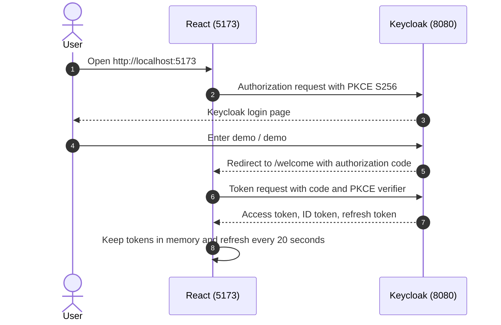
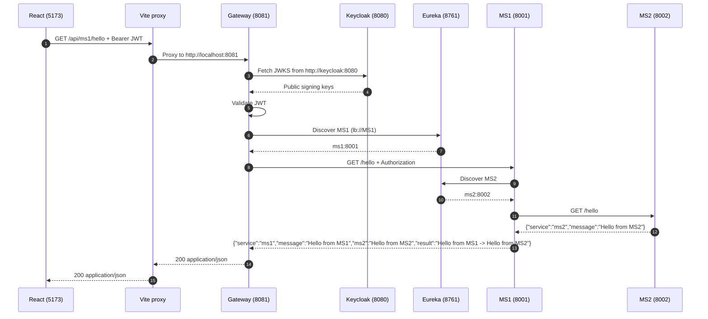
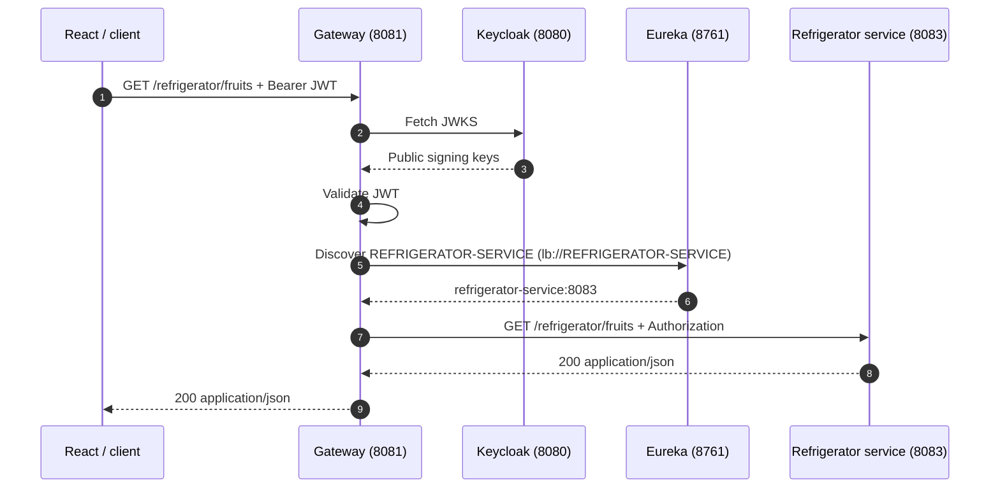
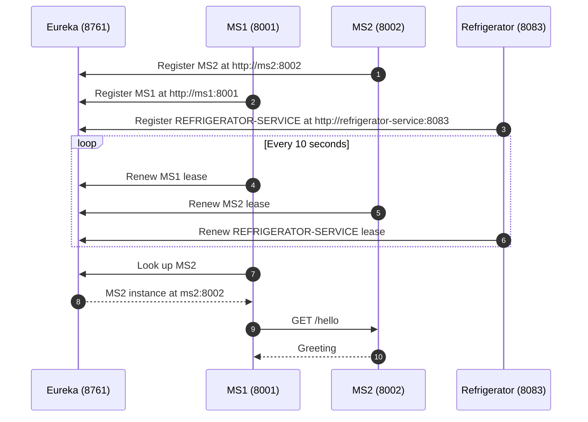

# Communication Architecture

This document explains how the React frontend, Keycloak, the Spring Cloud Gateway,
Eureka, and the two FastAPI microservices communicate in this project.

## Participants

| Component | Host port | Docker service name | Role |
| --- | --- | --- | --- |
| React frontend | `5173` | not containerized | Runs the browser UI with `keycloak-js`. |
| Keycloak | `8080` | `keycloak` | Issues and refreshes OIDC tokens. |
| Gateway | `8081` | `gateway` | Validates JWTs, routes API calls, and discovers services. |
| Eureka | `8761` | `eureka` | Service registry used by the gateway, MS1, and MS2. |
| MS1 | `8001` | `ms1` | FastAPI service that calls MS2 and combines the responses. |
| MS2 | `8002` | `ms2` | FastAPI service that returns its greeting. |
| PostgreSQL | not published | `postgres` | Keycloak database. |

## Network Boundaries

There are two different views of the system: the browser's view and the Docker
network's view.

### Browser-facing addresses

| Communication | Address |
| --- | --- |
| React app | `http://localhost:5173` |
| Keycloak | `http://keycloak.localhost:8080` |
| Gateway | `http://localhost:8081` |
| Eureka dashboard | `http://localhost:8761` |
| MS1 direct access | `http://localhost:8001` |
| MS2 direct access | `http://localhost:8002` |

The browser uses the Keycloak hostname `keycloak.localhost:8080`. Modern browsers
resolve `*.localhost` to loopback. If the browser cannot resolve it, add this to
`/etc/hosts`:

```text
127.0.0.1 keycloak.localhost
```

### Docker-internal addresses

Inside the Compose network, containers use service names:

| Communication | Address |
| --- | --- |
| Gateway to Keycloak JWKS | `http://keycloak:8080` |
| Gateway, MS1, MS2 to Eureka | `http://eureka:8761/eureka` |
| Gateway to MS1 | `http://ms1:8001` |
| MS1 to MS2 | `http://ms2:8002` |
| Keycloak to PostgreSQL | `jdbc:postgresql://postgres:5432/keycloak` |

`keycloak.localhost` is deliberately not used for the gateway's JWKS request.
Docker resolves `*.localhost` to loopback, so that name would point the gateway at
its own container. Instead, `docker-compose.yml` sets:

```yaml
KEYCLOAK_REALM_URL: http://keycloak.localhost:8080/realms/agriculture
KEYCLOAK_JWK_SET_URI: http://keycloak:8080/realms/agriculture/protocol/openid-connect/certs
```

The browser keeps the externally visible issuer URL, while the gateway fetches
signing keys from the internal service address.

### Local non-Docker addresses

When the services run directly on the host, the defaults use `localhost`:
gateway to Eureka at `http://localhost:8761/eureka`, gateway to Keycloak JWKS at
`http://localhost:8080/realms/agriculture/protocol/openid-connect/certs`, gateway
to MS1 via Eureka at `localhost:8001`, and MS1 to MS2 via Eureka at
`localhost:8002`.

## Authentication Flow

The React app uses the public Keycloak client `react-client` and the authorization
code flow with PKCE. The gateway does not participate in this login; it only
validates the resulting bearer token.

### Login and token acquisition



Relevant implementation:

- `frontend/src/auth/keycloak.js` configures `pkceMethod: 'S256'` and the
  `react-client` client.
- `frontend/src/auth/LoginController.jsx` starts the login, refreshes the token,
  and exposes the token to the React tree.
- `keycloak/realm-export.json` defines `react-client` as a public client with the
  standard authorization-code flow enabled.

### Token validation at the gateway

1. React sends the access token in the `Authorization: Bearer <token>` header.
2. The gateway's first `SecurityWebFilterChain` matches `/api/**`.
3. The gateway fetches Keycloak's public signing keys from the JWKS endpoint and
   validates the JWT signature and standard claims.
4. A missing, expired, or invalid token returns `401 Unauthorized`.
5. A valid token allows the request to continue to the route.

JWKS keys are cached after the first fetch. The gateway does not use `issuer-uri`;
it uses the explicit `jwk-set-uri`, which is why local and Docker runs can use
different Keycloak hostnames.

## End-to-End API Communication

The main business flow is:

```text
React -> Vite proxy -> Gateway -> MS1 -> MS2 -> MS1 -> Gateway -> React
```

### Request path

1. The Welcome page calls `fetchMs1Hello(token)`.
2. The frontend sends `GET /api/ms1/hello` with the bearer token.
3. In development, Vite proxies `/api` to `http://localhost:8081`.
4. The gateway's JWT resource-server chain (`/api/**` and `/refrigerator/**`) validates
   the JWT.
5. The `ms1_route` matches `Path=/api/ms1/**` before the generic `/api/**` route.
6. `StripPrefix=2` changes `/api/ms1/hello` into `/hello`.
7. The gateway resolves `lb://MS1` through Eureka and sends `GET /hello` to MS1.
8. The gateway forwards the original `Authorization` header to MS1.
9. MS1 looks up `MS2` in Eureka and calls `GET /hello` on MS2.
10. MS2 returns its greeting to MS1.
11. MS1 combines the greetings and returns the result to the gateway.
12. The gateway streams the JSON response back through the Vite proxy to React.

### Request sequence



### Refrigerator API flow

The refrigerator service is a separate Spring Boot microservice registered as
`REFRIGERATOR-SERVICE`. Its controllers stay under `/refrigerator/**`; the gateway
forwards the path unchanged.



### Route translation

| Incoming request | Gateway route | Outgoing request |
| --- | --- | --- |
| `GET /api/ms1/hello` | `ms1_route`, `lb://MS1`, `StripPrefix=2` | `GET http://ms1:8001/hello` |
| `GET /refrigerator/**` | `refrigerator_service_route`, `lb://REFRIGERATOR-SERVICE`, `TokenRelay` | `GET http://refrigerator-service:8083/refrigerator/**` |
| `GET /api/**` | `agriculture_service_route`, `TokenRelay` | `GET http://host.docker.internal:8082/**` by default |

The `ms1_route` has `order: -1`, so it is selected before the generic `/api/**`
route. The MS1 route does not use `TokenRelay`; the incoming bearer header is
forwarded as-is. The refrigerator route also has `order: -1` and keeps its
`/refrigerator/...` path because the service exposes the same paths.

## Microservice Discovery

MS1, MS2, and the refrigerator service do not use fixed service addresses. The FastAPI
services register themselves with Eureka during startup, and the Spring Boot
refrigerator service registers through `spring-cloud-starter-netflix-eureka-client`.



### Registration details

- `py-eureka-client` registers from the FastAPI lifespan using `init_async`.
- `EUREKA_APP_NAME` sets the registry name: `MS1` or `MS2`.
- `EUREKA_INSTANCE_HOST` sets the advertised hostname: `ms1` or `ms2` in Docker.
- The refrigerator service uses `spring.application.name: refrigerator-service`
  (registered as `REFRIGERATOR-SERVICE`) and the same `EUREKA_SERVER_URL` /
  `EUREKA_INSTANCE_HOST` conventions.
- The lease is renewed every 10 seconds.
- Eureka registry fetch interval for the Spring services is 5 seconds.
- Eureka self-preservation is disabled in this development setup.

### MS1 to MS2 call behavior

MS1 looks up `MS2` through `py-eureka-client` and calls `/hello`. It retries up to
15 times with a 3-second request timeout and short backoff while the registry
settles after startup. If all attempts fail, MS1 returns:

```json
{
  "detail": "MS2 is not available through Eureka"
}
```

with HTTP status `503`.

## Startup Order

`docker-compose.yml` uses health checks and dependencies to control startup:

1. The Keycloak and refrigerator PostgreSQL databases become healthy.
2. Keycloak starts and imports the `agriculture` realm.
3. Eureka starts and becomes healthy.
4. MS2 starts, registers with Eureka, and becomes healthy.
5. MS1 starts after Eureka and MS2, registers with Eureka, and becomes healthy.
6. The refrigerator service starts after Eureka and its PostgreSQL database, registers
   as `REFRIGERATOR-SERVICE`, and becomes healthy.
7. The gateway starts after Keycloak, Eureka, MS1, and the refrigerator service are
   healthy.

The gateway reports `GATEWAY`, MS1 reports `MS1`, MS2 reports `MS2`, and the
refrigerator service reports `REFRIGERATOR-SERVICE` in the Eureka registry.

## Response Contract

MS1 returns the combined result:

```json
{
  "service": "ms1",
  "message": "Hello from MS1",
  "ms2": "Hello from MS2",
  "result": "Hello from MS1 -> Hello from MS2"
}
```

The React Welcome page displays `message` as the MS1 value, `ms2` as the MS2 value,
and `result` as the final concatenated response.

## Security Boundaries and Caveats

- The React client is public and uses PKCE; no client secret is stored in the
  browser.
- The gateway client is confidential and is used for the gateway's browser-session
  OAuth2 flow.
- The `/api/**` and `/refrigerator/**` chains protect API calls with JWT validation.
- The non-API chain handles browser sessions with `oauth2Login` and `oauth2Client`.
- The generic `/api/**` route uses `TokenRelay`, which requires an OAuth2 client
  session. The MS1 route receives the original bearer token instead.
- The `/refrigerator/**` route uses `TokenRelay` and forwards requests to
  `REFRIGERATOR-SERVICE` without path rewriting.
- The gateway forwards the bearer token to MS1. MS1 does not forward that token to
  MS2.
- MS1, MS2, and the refrigerator service are also exposed directly on host ports
  `8001`, `8002`, and `8083`; those direct endpoints are not protected by the gateway
  in this development setup.
- The Vite `/api` proxy exists only in development. A production frontend must use
  the same origin as the gateway or configure CORS explicitly.
- The system uses HTTP for local development. Add TLS and issuer validation before
  treating this as a production deployment.

## Failure and Status Handling

| Symptom | Likely cause | Result |
| --- | --- | --- |
| API call has no token | Missing `Authorization` header | `401` from the gateway |
| API call has an expired/invalid token | Invalid JWT, wrong realm, or key mismatch | `401` from the gateway |
| React receives `401` | Token rejected during the call | React refreshes the token once and retries |
| Gateway cannot find MS1 | MS1 is not registered in Eureka | `503`/`502` from the gateway |
| Gateway cannot find `REFRIGERATOR-SERVICE` | The service is down or not registered in Eureka | `503`/`502` on `/refrigerator/**` |
| MS1 cannot find MS2 | MS2 is down or not registered yet | `503` with an MS2-unavailable detail |
| Keycloak JWKS is unreachable | Wrong hostname or Keycloak is down | JWT validation fails |
| Gateway cannot reach Keycloak at startup | `keycloak.localhost` not resolvable from browser | Check `/etc/hosts` or browser resolution |
| `*.localhost` works in browser but not in Docker | Docker resolves it to loopback | Use the internal `keycloak:8080` JWKS URL |

## Configuration Map

| File | Communication responsibility |
| --- | --- |
| `docker-compose.yml` | Service networking, ports, health checks, startup order, and internal Keycloak JWKS URL. |
| `src/main/resources/application.yaml` | Gateway routes, Eureka URL, Keycloak endpoints, and JWKS URL. |
| `src/main/java/com/workshop/gateway/config/SecurityConfig.java` | JWT-protected `/api/**` and `/refrigerator/**` chains plus the session-based browser chain. |
| `eureka-server/src/main/resources/application.yml` | Eureka registry behavior and dashboard port. |
| `refrigerator-service/src/main/resources/application.yml` | Refrigerator service port, PostgreSQL datasource, and Eureka registration. |
| `refrigerator-service/src/main/java/com/workshop/refrigerator/controller` | `/refrigerator/**` CRUD endpoints for fruits, vegetables, meals, and budgets. |
| `ms1/app/main.py` | MS1 Eureka registration and Eureka-based MS2 call with retries. |
| `ms2/app/main.py` | MS2 Eureka registration and `/hello` endpoint. |
| `frontend/src/auth/keycloak.js` | Keycloak URL, realm, public client, and PKCE configuration. |
| `frontend/src/auth/LoginController.jsx` | Login, token refresh, and token exposure to React. |
| `frontend/src/api/ms1.js` | Bearer-token request to `/api/ms1/hello`. |
| `frontend/vite.config.js` | Development proxy from `/api` to the gateway. |
| `keycloak/realm-export.json` | Realm, clients, redirect URIs, and demo user. |

## Verification Commands

With the Compose stack running:

```bash
# Eureka should show GATEWAY, MS1, MS2, and REFRIGERATOR-SERVICE as UP
curl -H 'Accept: application/json' http://localhost:8761/eureka/apps

# Direct service calls
curl http://localhost:8002/hello
curl http://localhost:8001/hello
curl http://localhost:8083/refrigerator/fruits

# Gateway without a token: expect 401
curl -i http://localhost:8081/api/ms1/hello
curl -i http://localhost:8081/refrigerator/fruits
```

To test the protected routes, send a valid Keycloak access token:

```bash
curl -H "Authorization: Bearer <access_token>" \
  http://localhost:8081/api/ms1/hello
curl -H "Authorization: Bearer <access_token>" \
  http://localhost:8081/refrigerator/fruits
```

Expected response:

```json
{
  "service": "ms1",
  "message": "Hello from MS1",
  "ms2": "Hello from MS2",
  "result": "Hello from MS1 -> Hello from MS2"
}
```
